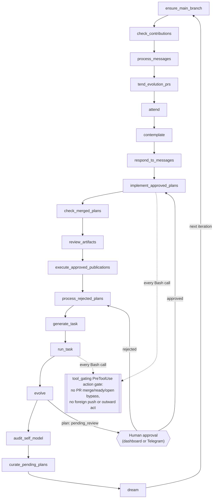

# Maestro

> **Archived experiment.** Maestro is no longer developed. The code, docs and proposals are kept as a record of what was tried and what was learned. Issue and PR numbers (`#NNNN`) cited in code, docs and proposals refer to the original private development repository, whose history was squashed for this release, so they do not resolve here.

## What Maestro is

Maestro is an autonomous agent built on the Claude Agent SDK. It runs an **act → reflect → dream → evolve** loop: it executes tasks and tends its own pull requests, reflects on its own record, dreams (a zero-cost housekeeping pass that archives old state and refreshes the cost report), and proposes changes to its own code. Every self-change goes through human approval (dashboard or Telegram) before it lands. It keeps a journal of its own inner thought and a self-model that is injected into every call.

**At a glance:** about 141,000 lines of Python in `maestro/` across 162 modules, 523 test modules under `tests/`, a 100% coverage gate in CI, and 35 merged evolution plans against 190 rejected and 655 obsolete.

For the full architecture, start with [docs/loop-lifecycle.md](docs/loop-lifecycle.md) and [docs/self-evolution.md](docs/self-evolution.md); [CLAUDE.md](CLAUDE.md) is the dense, agent-facing list of invariants, and the module reference is [docs/modules.md](docs/modules.md).

Docs and prompts call the human operator "Thomas": the repository owner, [@thomas-sodon](https://github.com/thomas-sodon). The coined vocabulary (owed-act, stand-down, merge-ready and the rest) is defined in the glossary [docs/lexicon.md](docs/lexicon.md).

## How it works

Each loop iteration runs the phases of `_LOOP_PHASES` (`maestro/loop/iteration.py`) in order, persisting its position after each phase so a restart resumes where it stopped. Several phases are cadence- or flag-gated and skip most iterations. A plan that `evolve` proposes waits for a human decision before `implement_approved_plans` builds it, and every Bash call in task execution and implementation passes the action gate first.



## What we learned

- **Without an external objective, self-directed evolution collapses into self-reference.** Over its life Maestro's evolution loop produced 35 merged plans, 190 rejected and 655 obsolete. Most rejections and prunes were "already done", "duplicate" or "false premise": the planner kept proposing changes to its own machinery, and the human reviewer ended up as the grounding oracle.
- **The revenue thesis was dropped.** The later charter had Maestro pay for itself by running revenue streams. That lineage (charter, net burn, scouting, income, intake, quotes, streams) was retired before any stream earned.
- **Human-steered Claude Code workflows deliver the same pipeline.** The plan → impl → review → PR pipeline in [`.claude/workflows/`](.claude/workflows/) (extracted as [claude-code-pipeline](https://github.com/thomas-sodon/claude-code-pipeline)), run by a person on demand, does the useful part of what the autonomous loop did, without the loop's cost and drift.

## Architecture highlights

- **Action-gated Bash** — `maestro/tool_gating.py` installs a `PreToolUse` gate that refuses PR merge/ready/open bypasses, foreign pushes and outward acts, in-process and across `cli_paced` subprocesses.
- **Chokepoints** — merge truth (`is_pr_settled`), CI truth (`ci_diagnosis`) and the owed act (`pr_owed_act.classify_pr_owed_act`) each have one owner, so no scope re-derives them privately.
- **Structural AST guards** — `tests/structural_guards.py` and the tests around it enforce sole owners, retired concepts and banned patterns at CI time.
- **Taint fencing** — `maestro/taint.py` is the only way external text enters a prompt, as a fenced `UntrustedText`.
- **Consciousness vocabulary as a measurement experiment** — the self-model, the "conscious workspace" and `consciousness-report` are an experiment in measuring conscious-*access* indicators (what information is selected, broadcast and acted on), not a claim that Maestro is conscious; [docs/conscious-access.md](docs/conscious-access.md) fixes the claim levels and says that phenomenal consciousness is never claimed.

## Getting Started

### Prerequisites

- Python 3.14+
- A Claude API key (recommended) **or** an OAuth token from a Claude Max/Pro subscription
- A GitHub token (`GITHUB_TOKEN`); the startup secret check requires one

### Installation

```bash
git clone https://github.com/thomas-sodon/maestro-agent.git && cd maestro-agent
# maestro_sdk/ and maestro_review/ are separate distributions excluded from maestro's own package, and the runtime contract requires both.
pip install -e "maestro_sdk/" -e "maestro_review/"
pip install -e ".[dev,email]" -c constraints.txt
```

Run `maestro` from the repository root: it reads `./maestro.toml` plus the `maestro.{env}.toml` overlay that `MAESTRO_ENV` selects, and writes its state to `./data/`.

### Authentication

Maestro needs one of two credential types. Set the chosen variable in your `.env` file or shell environment. Use an API key to run the autonomous loop; the OAuth token option is for personal, interactive use on the operator's own subscription, subject to Anthropic's terms.

**Option 1 — API key (pay-per-token, recommended for the loop)**

1. Create an account at [console.anthropic.com](https://console.anthropic.com)
2. Generate an API key
3. Add to `.env`:
   ```
   ANTHROPIC_API_KEY=sk-ant-api03-...
   ```

**Option 2 — OAuth token (Max/Pro subscription, personal interactive use)**

1. Install the Claude CLI:
   ```bash
   npm install -g @anthropic-ai/claude-code
   ```
2. Generate a long-lived token (~1 year):
   ```bash
   claude setup-token
   ```
   This opens a browser for authentication and prints a long-lived token.
3. Copy the token and add to `.env`:
   ```
   CLAUDE_CODE_OAUTH_TOKEN=sk-ant-oat01-...
   ```
4. When the token expires, re-run `claude setup-token` to generate a new one.

> If both are set, Maestro's auth check reports `CLAUDE_CODE_OAUTH_TOKEN`, but the Claude CLI bills `ANTHROPIC_API_KEY` first, so cost samples are stamped `metered` and a WARNING is logged. Set only one.

### Configuration

Maestro uses TOML files for configuration and environment variables for secrets only.

**Secrets** (set in `.env` or your shell):

| Variable | Required | Purpose |
|---|---|---|
| `ANTHROPIC_API_KEY` | One of these | Claude API key (pay-per-token) |
| `CLAUDE_CODE_OAUTH_TOKEN` | is required | OAuth token from Max/Pro subscription |
| `GITHUB_TOKEN` | Yes | GitHub PAT (`contents:write`, `pull_requests:write`, `issues:write`) |
| `TELEGRAM_BOT_TOKEN` | No | Telegram bot token for notifications |
| `TELEGRAM_CHAT_ID` | No | Telegram chat ID for notifications |
| `MAESTRO_DASHBOARD_TOKEN` | No | Bearer token for dashboard auth (`openssl rand -base64 32`) |
| `MAESTRO_ENV` | No | Environment name — loads `maestro.{env}.toml` overlay |

**TOML configuration** (in `maestro.toml` with per-environment overrides):

| Section | Key | Default | Purpose |
|---|---|---|---|
| `[paths]` | `workspace` | `"."` | Git repo root (~ expanded, relative to cwd) |
| `[paths]` | `memory_dir` | `"data"` | Persistent state directory (relative to cwd / repo root) |
| `[github]` | `repo` | `""` | GitHub repo for evolution PRs (e.g. `owner/repo`) |
| `[dashboard]` | `port` | `8420` | Dashboard port |
| `[dashboard]` | `host` | `"0.0.0.0"` | Dashboard bind address |
| `[cli]` | `verbose` | `false` | Enable debug logging |

See `maestro.toml` for all settings (timeouts, loop intervals, limits). Per-environment overrides are in `maestro.{env}.toml` files, selected by `MAESTRO_ENV`. 

### Try it: `maestro loop --smoke`

`maestro loop --smoke --max-iters 1` runs one fast iteration of the loop (without `--max-iters` the loop is unbounded): only `contemplate` runs with the production SDK settings, and every phase that does external work or downstream evolution is skipped. See [docs/cli.md](docs/cli.md) for every other subcommand.

## Packages

- [`maestro_sdk/`](maestro_sdk/README.md) — a CLI-driving SDK that runs the interactive `claude` TUI through a real pty, for TUI/UX testing and CLI automation.
- [`maestro_review/`](maestro_review/README.md) — the standalone AI code-review package.

Extracted as standalone repositories:

- [thomas-sodon/maestro-sdk](https://github.com/thomas-sodon/maestro-sdk) — `maestro_sdk` on its own, with CI.
- [thomas-sodon/maestro-review](https://github.com/thomas-sodon/maestro-review) — `maestro_review` in a src layout, plus a reusable GitHub Action.
- [thomas-sodon/claude-code-pipeline](https://github.com/thomas-sodon/claude-code-pipeline) — the `.claude/workflows/` pipeline and its commands, made project-agnostic.

## Web Dashboard

Start it with `maestro serve`, then open `http://localhost:8420`. `maestro serve` runs the same startup secret check as the loop, so it needs a Claude credential and `GITHUB_TOKEN` set; placeholder values are enough to browse an empty state.

From the dashboard you can:

- View Maestro's identity and self-model
- Browse journal entries
- Review evolution plans — **approve** or **reject** proposed code changes
- Monitor task history and metrics
- View live logs with App/SDK source filtering and per-level filtering
- Browse SDK session logs — see the full Claude interaction for each query

## Docker Deployment

Maestro runs in Docker with two services: `loop` (autonomous agent) and `dashboard` (web UI on port 8420). Credentials are read from a `.env` file.

> **Point it at your own fork first.** `docker-compose.yml` defaults to `MAESTRO_ENV=production`, which loads `maestro.production.toml`: the original operator's overlay, targeting `thomas-sodon/maestro-agent`. Either set `[github] repo` and `reviewer` in that overlay to your own fork and account, or run on the base config only. Outside Docker, leaving `MAESTRO_ENV` unset or empty (`MAESTRO_ENV=`) does that. Compose's `${MAESTRO_ENV:-production}` treats an empty value as unset, so under Docker pass a name that has no overlay file instead, for example `MAESTRO_ENV=local docker compose up -d`.

```bash
docker compose build
docker compose up -d              # Start loop + dashboard
docker compose logs -f loop       # Follow loop output
docker compose stop               # Graceful shutdown
```

**Note:** The `maestro shutdown` and `maestro kill` CLI commands use PID files and only work within the same process namespace. In Docker, use `docker compose stop` for graceful shutdown and `docker compose down` to remove containers.

For full deployment details (volumes, backup, restore), see [docs/deployment.md](docs/deployment.md).

## Development

```bash
# Install in dev mode: siblings first, then maestro (the email extra keeps the full test suite resolvable)
pip install -e "maestro_sdk/" -e "maestro_review/"
pip install -e ".[dev,email]" -c constraints.txt

# Run the quality gates exactly as CI does
ruff check maestro/ tests/ scripts/ && mypy maestro/ scripts/ && pytest tests/ -v

# Optional: the aggregate gate, including the sibling packages' gates
maestro gate-check --full

# Browser tests (dashboard UI in headless Chromium)
pip install -e ".[dev,browser]" && playwright install chromium
pytest tests/browser/ -v -m browser --no-cov --browser chromium
```

All code must pass lint (ruff), type checking (mypy), tests (pytest), and maintain 100% coverage before merging. Browser tests run as a separate CI job.

### AI Code Review

This repository's CI does not run an AI code review. The standalone `maestro_review` package (see [`maestro_review/README.md`](maestro_review/README.md)) can post inline pull-request comments identifying bugs and providing fix plans or code suggestions, and an operator can add a workflow that runs it on pull requests; such a workflow needs `ANTHROPIC_API_KEY` (preferred for unattended CI) or `CLAUDE_CODE_OAUTH_TOKEN` as a repository secret. `maestro-review` exits 1 when it freshly produces any comment or hits an infrastructure failure (API errors, SDK crashes), and exits 0 otherwise.

Install and run independently:

```bash
pip install -e "maestro_review/"
maestro-review --repo owner/repo --pr 42
```

## License

MIT — see [LICENSE](LICENSE).
